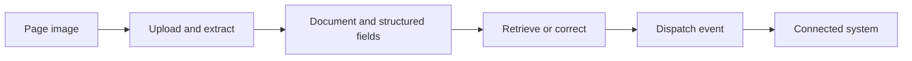

# Formalini Document AI API

**Documents in. Structured data out.** Turn page images, forms, invoices and receipts into structured data your application can use.

```text
PAGE IMAGE → FORMALINI → STRUCTURED DATA → YOUR APPLICATION
```

[See a worked demo](https://formalini.com/demo) · [Create a free account](https://formalini.com/auth) · [5-minute quickstart](docs/quickstart.md) · [API documentation](https://formalini.com/docs) · [Examples](examples/README.md)

Python · JavaScript · PHP · C# · Java · Go · Ruby · Rust · cURL

The [demo page](https://formalini.com/demo) shows a sample document and result. Sign in to process your own document. The API upload endpoint currently accepts JPEG, PNG, WebP and HEIC page images; render PDF pages to images before sending them.

## Verify your API key

Create a key under Integrations with `documents.read`, then run:

```sh
export FORMALINI_API_KEY="your_api_key_here"
curl "https://api.formalini.com/api/public/v1/documents?limit=10" \
  -H "Authorization: Bearer ${FORMALINI_API_KEY}"
```

The response contains a `documents` array. Each document can include its ID, name, status, and extracted fields. [Quickstart and upload example](docs/quickstart.md).

## Process your first document

Create a key with `documents.write`, then send a supported page image:

```sh
curl -X POST "https://api.formalini.com/api/public/v1/documents/upload" \
  -H "Authorization: Bearer ${FORMALINI_API_KEY}" \
  -F "file=@invoice-page-1.jpg" \
  -F "name=Invoice example"
```

The response contains a `document` with its ID and extracted fields. [Upload formats, limits, and asynchronous processing](docs/upload.md) · [API errors](docs/errors.md).

## SDKs

| Language | Status |
| --- | --- |
| [Python](sdks/python/README.md) | Six documented operations, mocked tests; unpublished |
| [JavaScript](sdks/javascript/README.md) | Six documented operations, mocked tests; unpublished |
| [PHP](sdks/php/README.md) | Six documented operations, mocked tests; unpublished |
| [C# / .NET](sdks/dotnet/README.md) | Six documented operations, mocked tests; unpublished |
| [Java](sdks/java/README.md) | Six documented operations, mocked tests; unpublished |
| [Go](sdks/go/README.md) | Six documented operations, mocked tests; unpublished |
| [Ruby](sdks/ruby/README.md) | Six documented operations, mocked tests; unpublished |
| [Rust](sdks/rust/README.md) | Six documented operations, mocked tests; unpublished |
| [cURL](sdks/curl/README.md) | Six copyable requests |

## Document lifecycle



The API provides [listing, creation, upload, retrieval, and correction](docs/documents.md), plus [workflow event dispatch](docs/workflows.md). See the [OpenAPI description](openapi/formalini-public-v1.yaml) for request shapes and [contract notes](docs/api-contract-report.md) for what remains unverified.

## Examples and next steps

[PDF to JSON](examples/pdf-to-json/README.md) · [Invoice to JSON](examples/invoice-to-json/README.md) · [Receipt to JSON](examples/receipt-to-json/README.md) · [Form data](examples/form-to-json/README.md) · [All examples](examples/README.md)

The [free account](https://formalini.com/auth) lets you generate an API key and test an integration. [Usage limits and additional credits](docs/free-usage.md) are managed by your account. Developers building for clients can read about the [partner program](docs/partner-program.md).

[Documentation index](docs/README.md) · [Contributing](CONTRIBUTING.md) · [Security policy](SECURITY.md)

The SDK source, examples and documentation are licensed under [Apache 2.0](LICENSE). The hosted Formalini service requires an account and API key and is governed by its [service terms](https://formalini.com/legal/terms). Free access has [usage limits](https://formalini.com/pricing); higher usage may require credits or a paid plan.

**Keep secret API keys server-side.** Never embed them in browser JavaScript, public mobile apps, public repositories or distributed client source. Use environment variables or a secrets manager. Never log Authorization headers.

Author: Marco Pascalini · contact@pascalini.com
